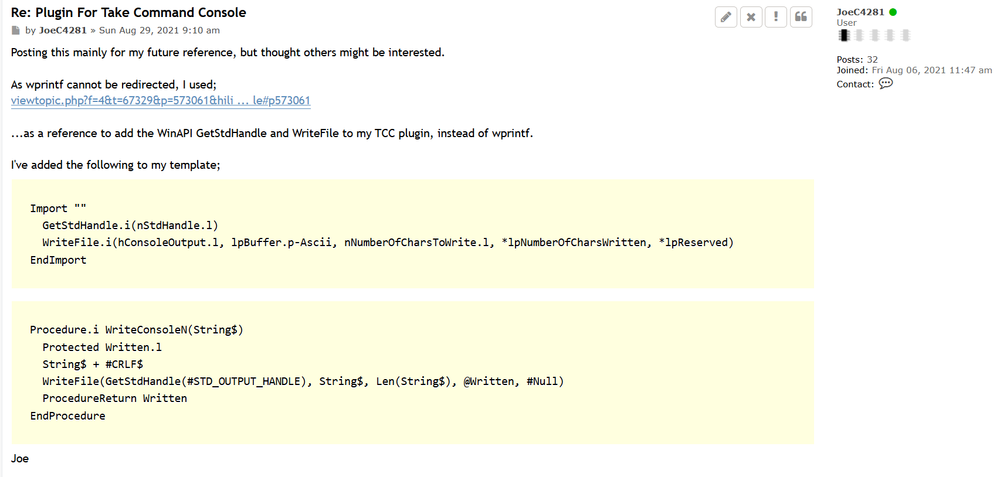

This is from https://www.purebasic.fr/english/viewtopic.php?p=573938&hilit=Plugin+for+Take+Command+Console#p573938 but can only be viewed if one is logged into the PureBasic Forum. 
  
  
  
Re-direction from a plugin written using PureBasic was not possible without this code.

I used this as a basis for doing the same thing for a .NET plugin. 

Ref: https://github.com/joec4281/jlcUtils/blob/main/jlcutils.cs#L323  
